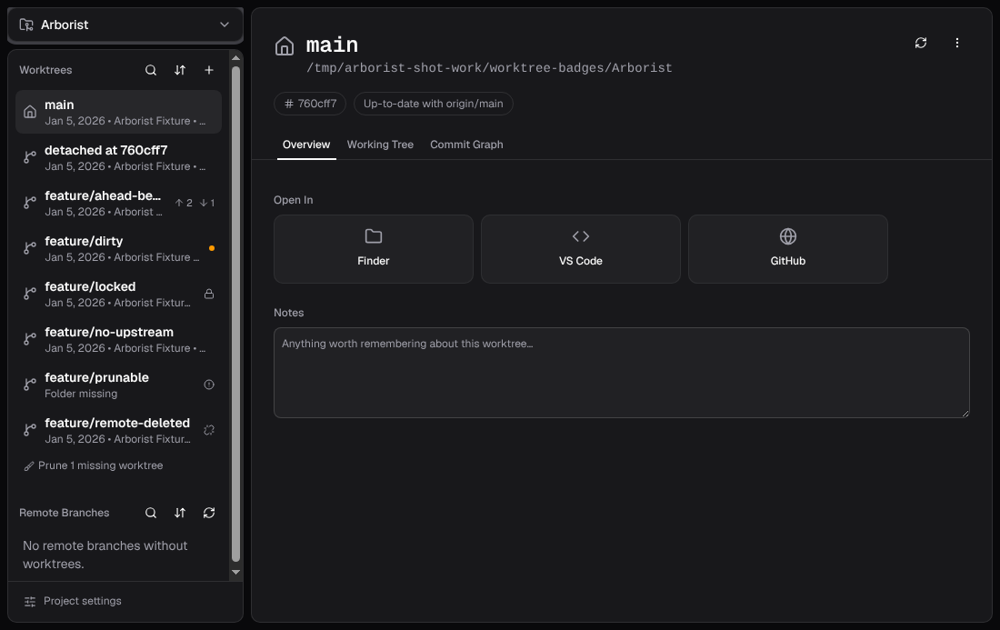

# Arborist

A git worktree manager for macOS, Windows and Linux. Arborist is designed to be a
much friendler interface for managing git worktrees than the terminal. It has
become a sort of worktree-based git client, with working tree and commit graph
tabs.



## Key Features

- **Git worktree management:** Create new worktrees from new or remote branches
- **Setup automations:** Automatically execute terminal commands whenever a new worktree is created. Useful for installing dependencies or copying environment variables.
- **"Open in" buttons:** Setup buttons that live on the overview tab for each worktree, allowing you to quickly open that worktree in your terminal, file explorer, code editor, or even on GitHub.
- **Working tree and commit graph support:** see a full git history, relative to the selected worktree. Drill down into previous commits and diffs.

## Installing

Download the latest build from
[Releases](https://github.com/zaccomode/arborist-2/releases).

Arborist automatically checks for updates on launch and every six hours while open.

## Development

```bash
npm install
npm run dev
```

## Checks

```bash
npm run lint        # ESLint
npm run typecheck   # tsc for node + web configs
npm test            # Vitest unit and integration tests
npm run test:e2e    # builds, then runs the Playwright smoke test
npm run screenshot  # builds, then captures every UI scenario (key screens into docs/screenshots, the rest into .screenshots)
```

CI runs the first four on macOS and Windows for every push and pull request.

## Building and Releasing

```bash
npm run build:mac   # dmg + zip, arm64 and x64
npm run build:win   # NSIS installer, x64
```

Both produce unsigned builds locally, which is fine for a look and not fine for
handing to anyone. Releases are cut by merging a pull request that bumps the
version in `package.json`: CI tags the merge, builds and signs it, and uploads a
draft. [docs/release.md](docs/release.md) is the runbook.

## Further Reading

- [docs/troubleshooting.md](docs/troubleshooting.md)
