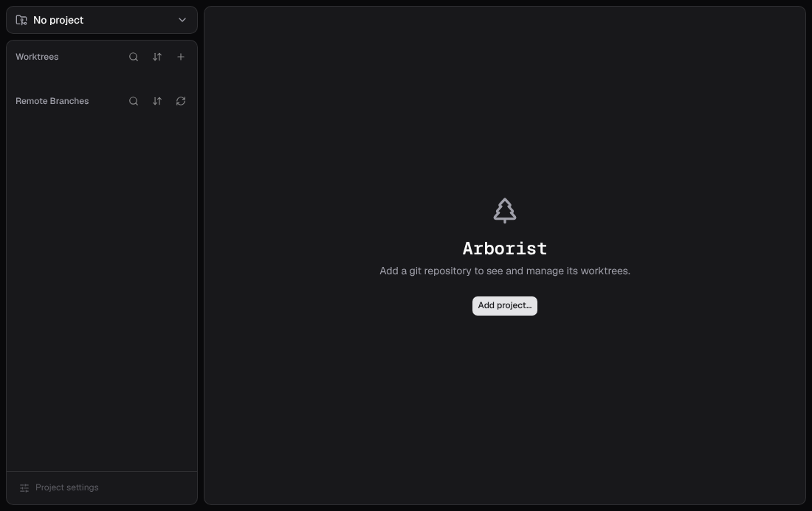
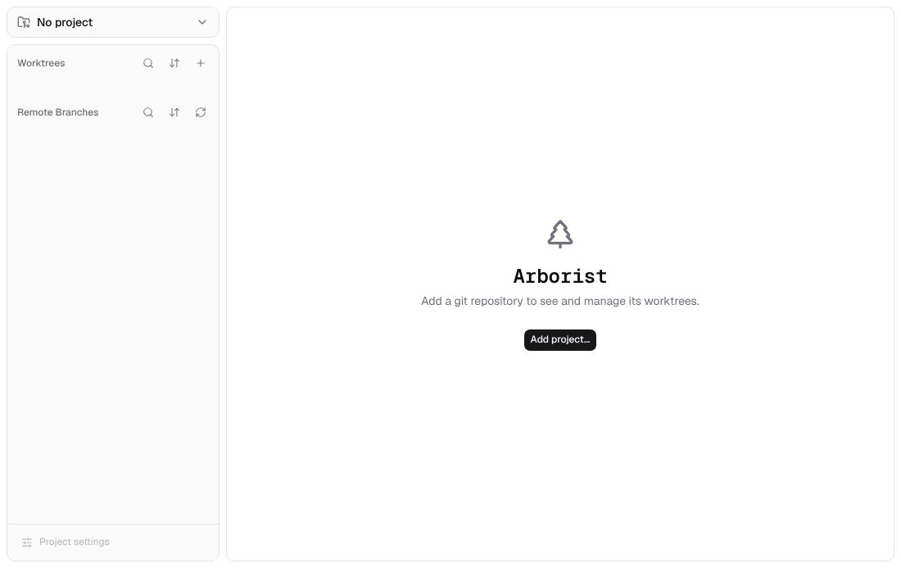
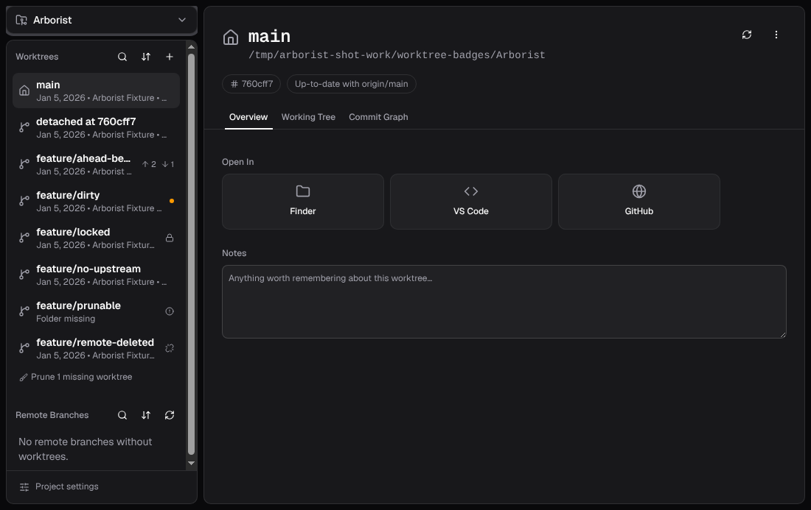
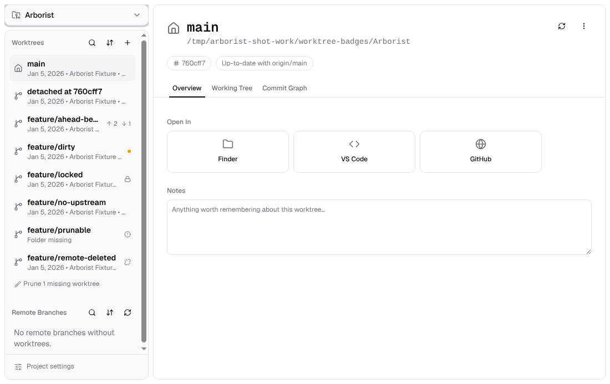
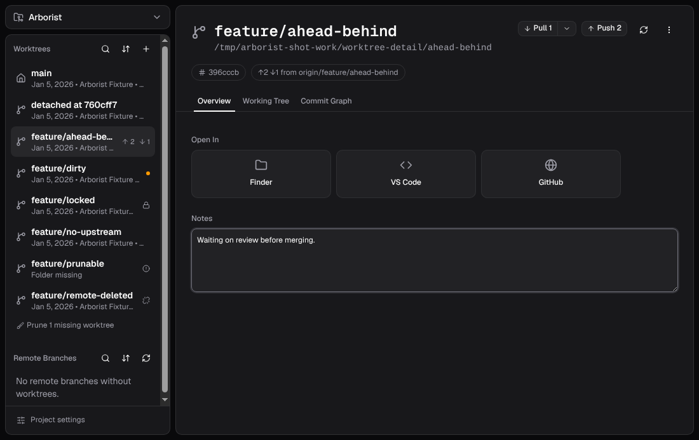
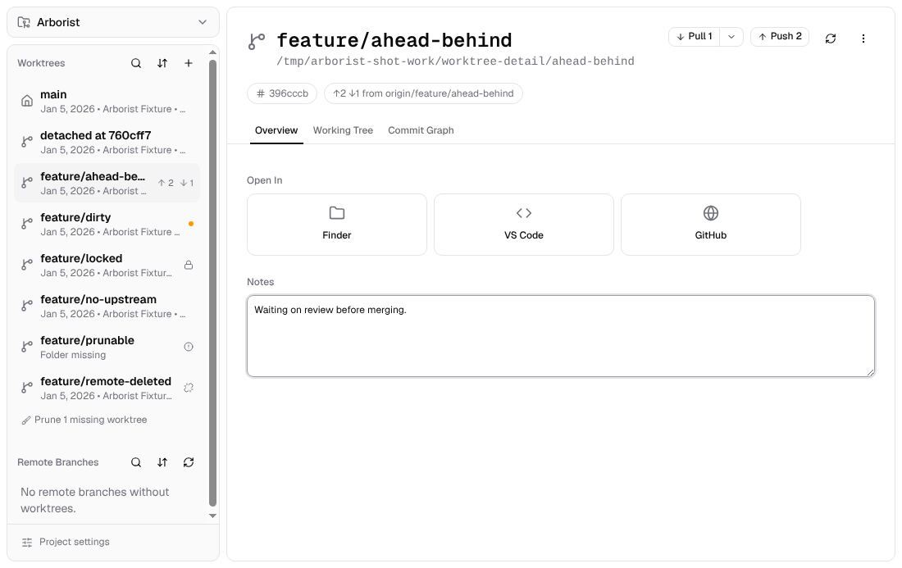
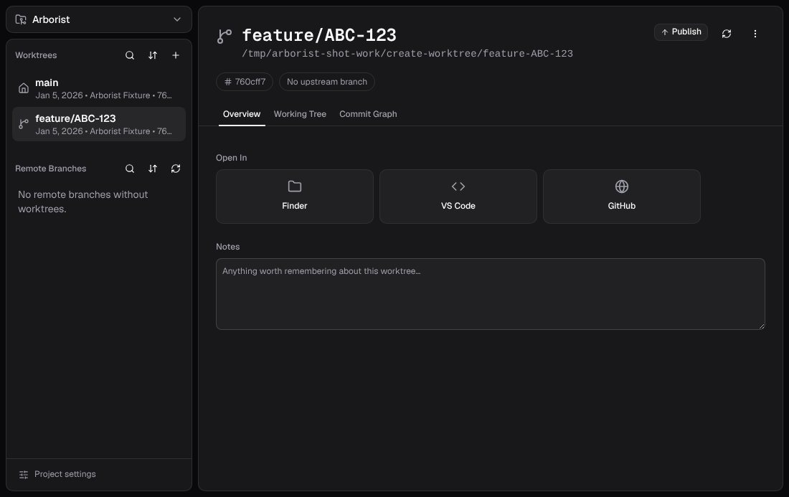
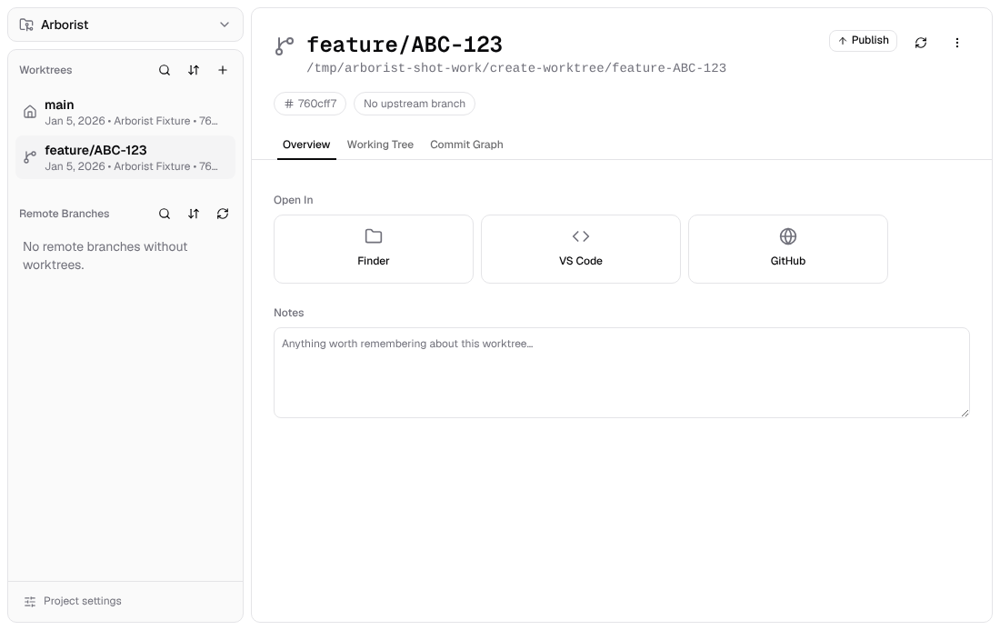
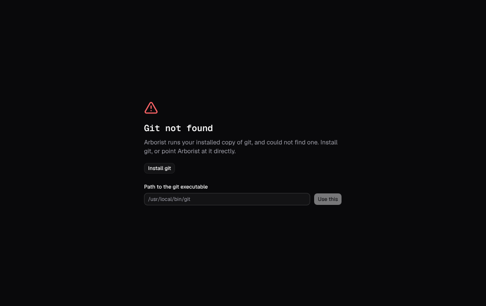
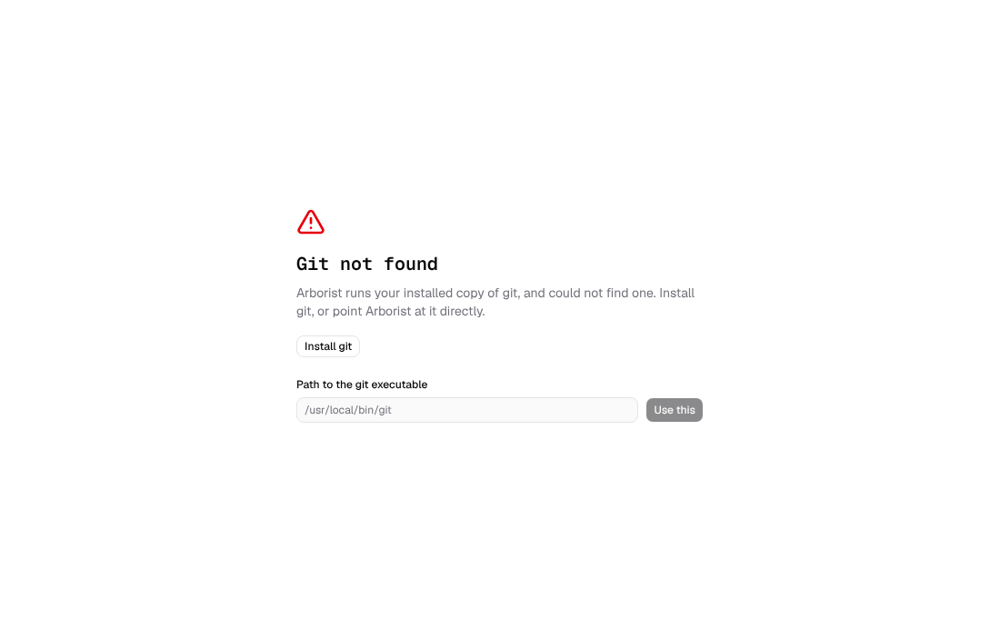

# Screenshots

A small set of key screens, captured from the real Electron window. Only these are committed; every other scenario in `scripts/screenshots/scenarios.ts` still runs, but writes to the gitignored `.screenshots/` directory so regenerating doesn't churn the repository (#99).

Regenerate with `npm run screenshot`, or `xvfb-run -a npm run screenshot` on Linux. A scenario is committed only if it sets `committed: true`; keep that to genuinely key screens. `CLAUDE.md` covers the workflow.

Captures are deterministic within one environment, but not across them: font rasterisation differs between macOS and Linux, so the committed images are generated in the Linux cloud container.

| Scenario           | What it shows                                                                | Dark                                     | Light                                     |
| ------------------ | ---------------------------------------------------------------------------- | ---------------------------------------- | ----------------------------------------- |
| `shell`            | The two-pane shell as the app opens, with no project. Compare `concept.png`. |                     |                     |
| `worktree-badges`  | The sidebar over the full badge matrix.                                      |           |           |
| `worktree-detail`  | The detail pane: ahead and behind with a note, and a missing folder.         |  |  |
| `create-worktree`  | Creating a worktree, before and after.                                       |     |     |
| `settings`         | App settings.                                                                | see `settings-*`                         | see `settings-*`                          |
| `project-settings` | Project settings.                                                            | see `project-settings-*`                 | see `project-settings-*`                  |
| `git-not-found`    | The blocking screen when git is missing.                                     |             |             |

---

Relative paths like the ones above only resolve inside repository files. A pull request body needs an absolute `github.com/.../blob/<sha>/...?raw=true` URL instead.
